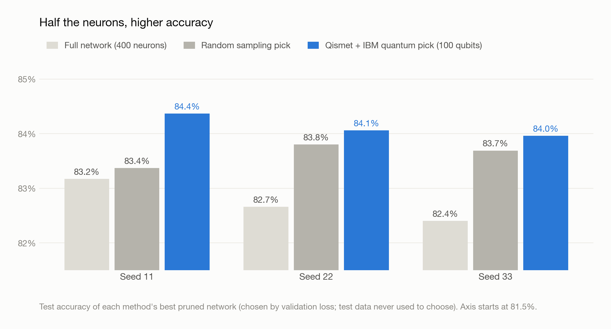
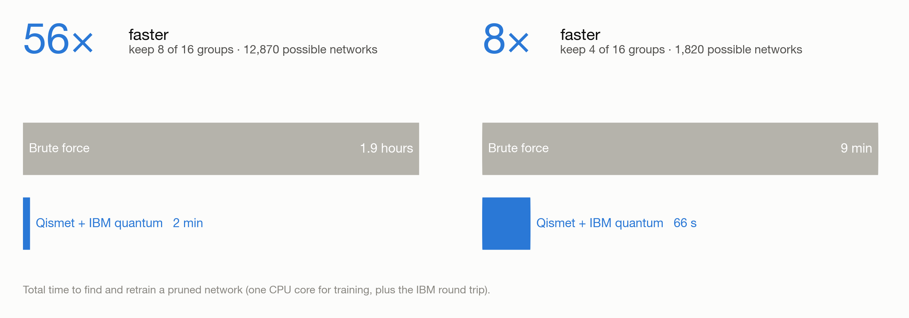
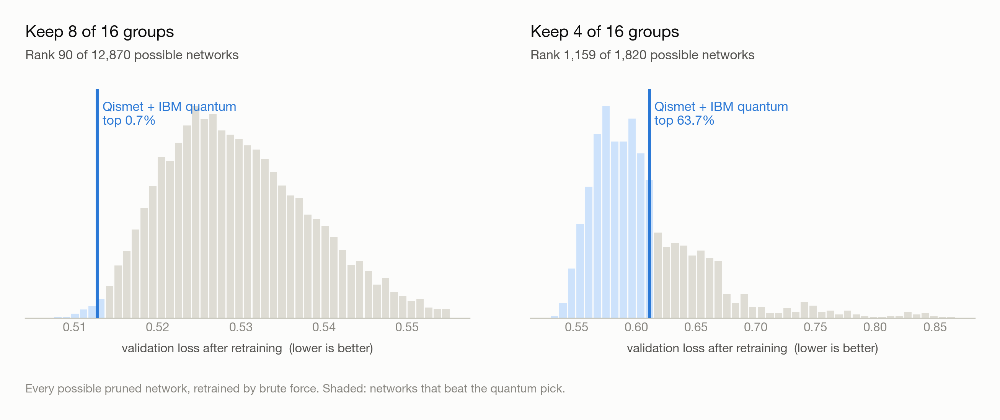
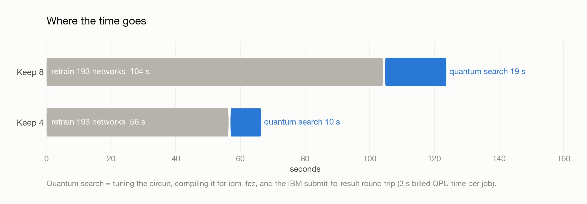
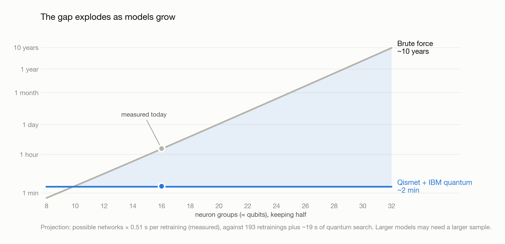

# Qismet

**Quantum-assisted neural network pruning.** Qismet finds a small, accurate version of a neural network without retraining every possibility. It retrains a small sample, learns which neuron combinations train well, and has an IBM quantum computer search for the best one.

<table>
<tr>
<td align="center"><h1>56×</h1>faster than brute force</td>
<td align="center"><h1>100</h1>qubits on IBM's <b>ibm_fez</b></td>
<td align="center"><h1>84.4%</h1>test accuracy with half the neurons<br><sub>full network: 83.2%</sub></td>
<td align="center"><h1>3 s</h1>of quantum time per search</td>
</tr>
</table>

## 100 qubits on IBM hardware

The flagship test: a bigger network (**784 → 400 → 10**, 200 neuron groups) where each of **100 qubits** on ibm_fez chooses between two neuron groups. That gives **2¹⁰⁰ ≈ 10³⁰** possible pruned networks, far beyond what any computer could retrain. The rules and the success criterion were [pre-registered and pushed to GitHub](outputs/hw100_v6/PREREGISTRATION.md) before any network was trained or any job was run.

<picture>
  <source media="(prefers-color-scheme: dark)" srcset="outputs/scale16_v5/speed_race/figures/hw100_dark.png">
  
</picture>

| | Seed 11 | Seed 22 | Seed 33 |
|---|---:|---:|---:|
| Full network (400 neurons) | 83.2% | 82.7% | 82.4% |
| Random sampling's best pick (200 neurons) | 83.4% | 83.8% | 83.7% |
| **Qismet + IBM quantum's best pick (200 neurons)** | **84.4%** | **84.1%** | **84.0%** |

- **Pre-registered win over random sampling.** At the same budget of 4,096 candidates, the quantum computer's picks trained to lower validation loss (2 of 3 seeds, lower average: 0.501 vs 0.509), as the rule required.
- **It matched a classical simulated annealer** given the same 4,096-candidate budget (average best loss 0.5014 vs 0.5014).
- **Higher accuracy with half the neurons:** in every seed, the quantum-selected network beat the full 400-neuron network on the test set, by 1.2 to 1.6 points.
- **Near-noiseless hardware:** the circuit uses only the chip's native connections (200 two-qubit gates, zero routing gates). Its output quality was within 0.004 of a perfect, noiseless quantum computer on every seed.
- **Strong candidates:** 82–84% of the quantum computer's 4,096 candidates scored better than the *best* of 4,096 random guesses.
- **Cheap:** 3 seconds of billed quantum time per job. IBM job IDs: `dbmn0l9kbkrc73cprbl0`, `dbmvgcl8mdtc73d8nl7g`, `dbmvnot8ft8s738vkd50`.

Full pre-registered results for every method and seed are in [`outputs/hw100_v6/RESULTS.md`](outputs/hw100_v6/RESULTS.md).

## The problem

Pruning makes a neural network smaller by removing neurons. The hard part is choosing **which** neurons to remove: every choice has to be retrained to see how good it is, and the number of choices explodes with network size.

Our test network classifies Fashion-MNIST clothing images: **784 inputs → 32 hidden neurons → 10 classes**. Its 32 hidden neurons form **16 groups**. Keeping 8 of the 16 groups gives **12,870** possible smaller networks.

| | How it finds the best smaller network |
|---|---|
| **Brute force** | Retrain all 12,870 networks and keep the best one. |
| **Qismet + IBM quantum** | Retrain a sample of 192 networks and learn a formula that predicts how well any choice will train. Encode the formula as a 16-qubit QAOA circuit, one qubit per neuron group, and run it on IBM's **ibm_fez** quantum computer. Its measurements are candidate networks. The most promising one is retrained. |

## 16-qubit speed race vs brute force

### Speed

<picture>
  <source media="(prefers-color-scheme: dark)" srcset="outputs/scale16_v5/speed_race/figures/speed_dark.png">
  
</picture>

| | Keep 8 of 16 groups | Keep 4 of 16 groups |
|---|---:|---:|
| Possible networks | 12,870 | 1,820 |
| **Brute force** | 1.9 hours · 12,870 retrainings | 9.0 min · 1,820 retrainings |
| **Qismet + IBM quantum** | **2.1 min** · 193 retrainings | **66 s** · 193 retrainings |
| **Speedup** | **56×** | **8×** |

Qismet needs only 193 retrainings, about 1.5% of the networks at keep 8. The quantum search on ibm_fez returns its candidate networks in seconds.

### Quality

Brute force retrained every network, so every pick can be ranked against all of them.

<picture>
  <source media="(prefers-color-scheme: dark)" srcset="outputs/scale16_v5/speed_race/figures/quality_dark.png">
  
</picture>

| | Keep 8 | Keep 4 |
|---|---:|---:|
| Rank of the quantum pick | **90 of 12,870 (top 0.7%)** | 1,159 of 1,820 (top 64%) |
| Validation accuracy of the quantum pick | **83.3%** | 78.9% |
| Brute force's best (lowest validation loss) | 82.4% | 82.9% |
| Full, unpruned network | 82.6% | 82.6% |

At keep 8, the quantum-selected network uses **half the neurons** and scored **higher validation accuracy than the full network** (83.3% vs 82.6%). Ranks use validation loss, which every method minimizes; the test set was not used.

### Where the time goes

<picture>
  <source media="(prefers-color-scheme: dark)" srcset="outputs/scale16_v5/speed_race/figures/breakdown_dark.png">
  
</picture>

| Step | Keep 8 | Keep 4 |
|---|---:|---:|
| Retrain 192 sample networks | 103.6 s | 56.0 s |
| Fit the prediction formula | 0.05 s | 0.04 s |
| Tune the QAOA circuit | 0.9 s | 0.1 s |
| Compile for ibm_fez | 2.4 s | 1.4 s |
| IBM submit → results | 15.7 s | 8.0 s |
| Billed quantum time | 3 s | 3 s |
| Retrain the chosen network | 0.5 s | 0.3 s |

### As models grow

<picture>
  <source media="(prefers-color-scheme: dark)" srcset="outputs/scale16_v5/speed_race/figures/scaling_dark.png">
  
</picture>

Each added neuron group roughly doubles the number of possible networks. Brute force goes from about **2 hours** (16 groups) to **1 day** (20), **2 weeks** (24) and **10 years** (32). Qismet's cost is set by its sample size and stays at a few minutes. This is a projection from today's measured 0.51 s per retraining. Larger models may need a larger sample.

## Notes on the 16-qubit run

- **Keep 4 is harder.** The quantum pick landed in the top 64%, 4 points below the best network.
- **Hardware noise.** The 16-qubit circuit compiled to about 950 two-qubit gates. At keep 8, the share of measurements that were valid networks (20.6%) was close to what random bits give (19.6%), so the top-0.7% result partly reflects favorable sampling. Matching the circuit to the chip's wiring fixed this in the 100-qubit test above.
- **Scale:** one initialization, one data split and one hardware run per pruning level.

## Reproduce

From `outputs/scale16_v5/`:

```bash
python experiment.py                                      # sample retraining, formula fit, QAOA angles (seed 1001 done)
python brute_force.py --seed 1001 --keep 4 --workers 6
python brute_force.py --seed 1001 --keep 8 --workers 6    # ~20 min on 6 cores
python speed_race.py qpu                                  # IBM hardware run; credentials via outputs/ibm_setup.py
python speed_race.py report
python speed_race/make_figures.py
```

## Data

| File | Contents |
|---|---|
| [`speed_race/qpu_keep_8.json`](outputs/scale16_v5/speed_race/qpu_keep_8.json), [`qpu_keep_4.json`](outputs/scale16_v5/speed_race/qpu_keep_4.json) | IBM job IDs (`dbmjfpm74qds73dsdehg`, `dbmjfthkbkrc73cpk6d0`), timings, compiled circuit size and IBM usage |
| `speed_race/keep_*_shots.npy` | All 4,096 raw hardware measurements per job |
| [`brute_force/`](outputs/scale16_v5/brute_force/) | Validation loss, accuracy and training time for every possible network |
| [`speed_race/figures/`](outputs/scale16_v5/speed_race/figures/) | Charts in light and dark versions |

All paths are relative to `outputs/scale16_v5/`.

## Earlier experiments

[Fashion-MNIST experiment](outputs/fashion_v2/README.md): grouped neuron pruning with classical selectors and simulated QAOA.

See the [executed notebook](outputs/fashion_v2/Fashion_Qismet.ipynb), [results](outputs/fashion_v2/RESULTS.md), and [runtime comparison](outputs/fashion_v2/RUNTIME.md).
