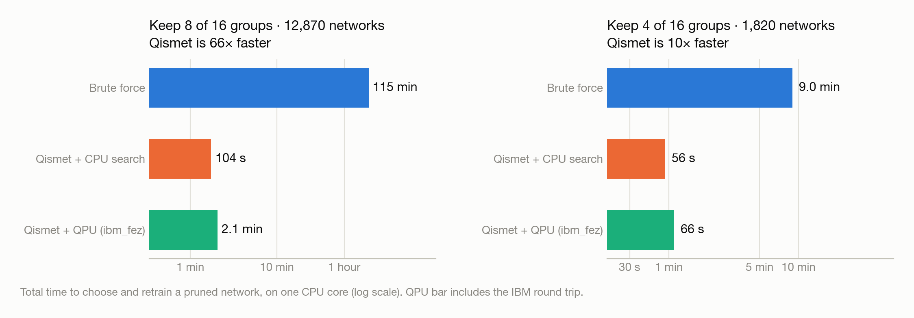
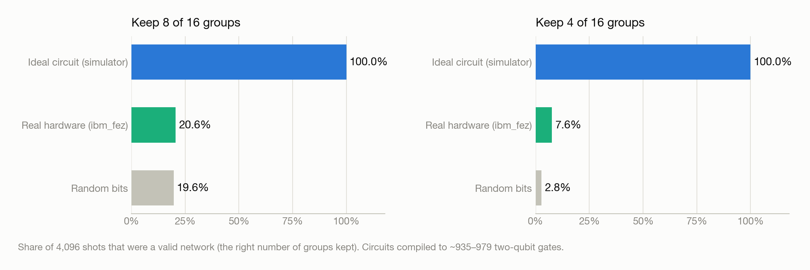

# Qismet

## Speed race: Qismet vs brute force

**Qismet found a good pruned network 66× faster than retraining every possible network, and its quantum search step ran on real IBM hardware.**

<table>
<tr>
<td align="center"><h2>66×</h2>faster than brute force<br><sub>keep 8 of 16 groups</sub></td>
<td align="center"><h2>193</h2>networks retrained<br><sub>instead of 12,870</sub></td>
<td align="center"><h2>16</h2>qubits on <b>ibm_fez</b><br><sub>one per neuron group</sub></td>
<td align="center"><h2>6 s</h2>of billed QPU time<br><sub>for both pruning levels</sub></td>
</tr>
</table>

## The race

**The problem:** a Fashion-MNIST classifier with **784 inputs → 32 hidden neurons → 10 classes** (25,450 weights). The 32 hidden neurons form **16 groups of 2**. Pruning means choosing which groups to keep. Keeping 8 of 16 gives **12,870** possible smaller networks. Keeping 4 of 16 gives **1,820**. The goal is to find the one that trains best after pruning.

Three ways to find it:

| | How it works |
|---|---|
| **Brute force** | Retrain every possible network and keep the one with the lowest validation loss. Guaranteed best, but slow. |
| **Qismet + CPU search** | Retrain a sample of 192 networks, fit a formula (a QUBO) that predicts how well any choice will train, find the formula's best choice on a CPU, then retrain that one. |
| **Qismet + QPU search** | Same sample and formula, but the formula is searched by a 16-qubit QAOA circuit on a real IBM quantum computer. It takes the best valid network among the first 32 measurements, then retrains that one. |

Every network starts from the same original weights (seed 1001) and trains the same way (20 epochs, Adam, learning rate 0.003). Every time below was measured on the same Mac on one CPU core, plus the IBM round trip for the QPU pipeline.

## 1. Speed

<picture>
  <source media="(prefers-color-scheme: dark)" srcset="outputs/scale16_v5/speed_race/figures/time_dark.png">
  
</picture>

| | Keep 8 of 16 (12,870 networks) | Keep 4 of 16 (1,820 networks) |
|---|---:|---:|
| **Brute force** | 114.9 min · 12,870 retrainings | 9.0 min · 1,820 retrainings |
| **Qismet + CPU search** | **104 s** · 193 retrainings · **66× faster** | **56 s** · 193 retrainings · **9.6× faster** |
| **Qismet + QPU search** | **123 s** · 193 retrainings · **56× faster** | **66 s** · 193 retrainings · **8.2× faster** |

Brute force with 6 CPU cores in parallel still took 19.3 min (keep 8) and 1.6 min (keep 4).

## 2. How good was each pick?

Brute force retrained every network, so each method's pick can be ranked against all of them.

<picture>
  <source media="(prefers-color-scheme: dark)" srcset="outputs/scale16_v5/speed_race/figures/quality_dark.png">
  
</picture>

| | Keep 8: rank (of 12,870) | Keep 8: val. accuracy | Keep 4: rank (of 1,820) | Keep 4: val. accuracy |
|---|---:|---:|---:|---:|
| **Brute force** | 1 (true best) | 82.4% | 1 (true best) | 82.9% |
| **Qismet + CPU search** | 4,016 (top 31%) | 82.9% | 264 (top 15%) | 80.4% |
| **Qismet + QPU search** | 90 (top 0.7%) | 83.3% | 1,159 (top 64%) | 78.9% |
| *Full 32-neuron network* | – | *82.6%* | – | *82.6%* |

Ranks use validation loss, the quantity every method tries to minimize. Validation accuracy can rank networks a little differently. That's why the keep-8 Qismet picks show *higher* accuracy than the lowest-loss network. The test set was not used.

At keep 8, 88% of all possible networks land within 1 point of the full network's accuracy, so even a top-31% pick is a good network. At keep 4 only 5% do (the median is 79.0%), so choosing well matters more. There the faster pick costs 2.5 points against the true best.

## 3. Where Qismet's time goes

<picture>
  <source media="(prefers-color-scheme: dark)" srcset="outputs/scale16_v5/speed_race/figures/breakdown_dark.png">
  
</picture>

| Step | Keep 8 | Keep 4 |
|---|---:|---:|
| Retrain 192 sample networks | 103.6 s | 56.0 s |
| Fit the QUBO formula | 0.05 s | 0.04 s |
| Tune QAOA circuit angles (CPU simulator) | 0.9 s | 0.1 s |
| Compile the circuit for ibm_fez | 2.4 s | 1.4 s |
| IBM submit → result (queue + run + transfer) | 15.7 s | 8.0 s |
| Billed QPU time | 3 s | 3 s |
| Retrain the chosen network | 0.5 s | 0.3 s |

The same search on a CPU takes **0.26 ms** (keep 8) and **0.05 ms** (keep 4), because it scores every option of the formula directly.

## 4. What the quantum computer returned

<picture>
  <source media="(prefers-color-scheme: dark)" srcset="outputs/scale16_v5/speed_race/figures/noise_dark.png">
  
</picture>

The circuit is designed to output only valid networks (exactly 8 or exactly 4 groups kept), and on a perfect simulator it does that 100% of the time. On ibm_fez, connecting all 16 qubits to each other required **935–979 two-qubit gates** after compilation, and noise built up:

- **Keep 8:** 20.6% of shots were valid, about the same as random bits (19.6%). The QPU's strong keep-8 pick came from 6 valid shots among the first 32, which is mostly luck.
- **Keep 4:** 7.6% of shots were valid, 2.7× better than random bits (2.8%), so some signal survived. The pick still landed in the bottom half.

## 5. What happens with bigger networks

<picture>
  <source media="(prefers-color-scheme: dark)" srcset="outputs/scale16_v5/speed_race/figures/scaling_dark.png">
  
</picture>

The number of possible networks explodes as groups are added. Brute force goes from about 2 hours (16 groups) to about 1 day (20), 2 weeks (24) and 10 years (32). Qismet's cost is set by its sample size, so it stays at a few minutes. This is a projection from today's measured 0.51 s per retraining, not a measurement. A bigger model may need a larger sample to keep the formula accurate.

## What this shows

- ✅ **Qismet is much faster than brute force:** 66× at 12,870 options, and the gap grows quickly with model size.
- ✅ **Its picks are good, but not the best.** At keep 8 the CPU pick's accuracy (82.9%) was as high as the lowest-loss network's (82.4%). It ranked in the top 31% by loss at keep 8, and the top 15% at keep 4 (2.5 points below the best).
- ✅ **The quantum step runs on real hardware:** 16 qubits on ibm_fez, results back in 8–16 seconds.
- ⚠️ **The speedup comes from the Qismet method, not from the QPU.** Swapping the CPU search for the QPU added 10–19 seconds, and at this circuit size hardware noise was close to random.
- ⚠️ **Next steps to make the QPU useful:** circuits that match the chip's wiring (fewer two-qubit gates), and a more accurate formula. Even the formula's exact best was only top 31% / top 15%.

One seed, one dataset split and one hardware run per pruning level. Treat these numbers as a demonstration, not a benchmark.

## Reproduce

From `outputs/scale16_v5/`:

```bash
python experiment.py                                 # sample retraining, QUBO fit, QAOA angles (already done for seed 1001)
python brute_force.py --seed 1001 --keep 4 --workers 6
python brute_force.py --seed 1001 --keep 8 --workers 6   # ~20 min on 6 cores
python speed_race.py qpu                             # IBM hardware run, needs ~/.qiskit credentials (see outputs/ibm_setup.py)
python speed_race.py report                          # writes speed_race/speed_race.csv and raw_report.md
python speed_race/make_figures.py                    # charts in speed_race/figures/
```

## Files

All in `outputs/scale16_v5/speed_race/` unless noted.

| File | Contents |
|---|---|
| [`speed_race.csv`](outputs/scale16_v5/speed_race/speed_race.csv) | Final numbers for every pipeline and pruning level |
| [`qpu_keep_8.json`](outputs/scale16_v5/speed_race/qpu_keep_8.json), [`qpu_keep_4.json`](outputs/scale16_v5/speed_race/qpu_keep_4.json) | IBM job IDs (`dbmjfpm74qds73dsdehg`, `dbmjfthkbkrc73cpk6d0`), timings, compiled circuit size, IBM usage and timestamps |
| `outputs/scale16_v5/speed_race/keep_*_shots.npy` | All 4,096 raw hardware measurements per job, in shot order |
| [`outputs/scale16_v5/brute_force/`](outputs/scale16_v5/brute_force/) | Validation loss, accuracy and training time for every possible network |
| [`raw_report.md`](outputs/scale16_v5/speed_race/raw_report.md) | Auto-generated report from `speed_race.py report` |
| [`figures/`](outputs/scale16_v5/speed_race/figures/) | Every chart, in light and dark versions |

## Earlier experiments

[Fashion-MNIST experiment](outputs/fashion_v2/README.md): grouped neuron pruning with classical selectors and simulated QAOA.

See the [executed notebook](outputs/fashion_v2/Fashion_Qismet.ipynb), [results](outputs/fashion_v2/RESULTS.md), and [runtime comparison](outputs/fashion_v2/RUNTIME.md).
