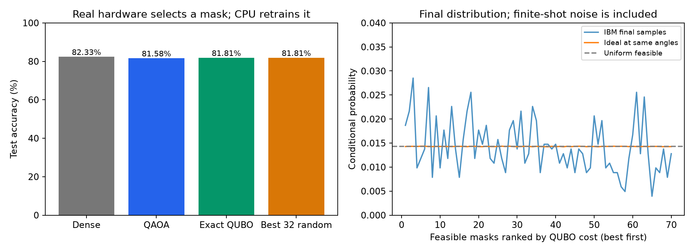

# Qismet: completed IBM hardware experiment

This experiment ran eight real jobs on **ibm_kingston**, using **17 seconds** of reported QPU usage and **9,216 shots**. No simulator substituted for hardware. IBM job IDs and raw results are saved below.

The classifier is the existing Fashion-MNIST 784→16→10 network. Each of eight qubits represents a pair of hidden neurons. This run keeps four pairs, uses the original initialization, and retrains each final network for the same 20 epochs on the CPU. Only seed 11 is used here.

| Method | Parameters | Validation accuracy | Test accuracy | Validation drop |
|---|---:|---:|---:|---:|
| Dense | 12,730 | 82.30% | 82.33% | 0.00 pp |
| QAOA selected | 6,370 | 81.40% | 81.58% | 0.90 pp |
| Exact QUBO | 6,370 | 81.90% | 81.81% | 0.40 pp |
| Best of 32 random | 6,370 | 81.90% | 81.81% | 0.40 pp |

## How the quantum algorithm was used

The fitted QUBO receives a fixed-size penalty, then maps exactly to an Ising cost operator. Two alternating cost/mixer layers form QAOA. The first hardware job replays saved simulator-optimized angles. Three SPSA steps use six additional hardware evaluations. A separate final job samples the best observed angles. The primary mask is selected by QUBO score from 32 seeded draws from those final measurements. Classical best-of-32 draws from feasible masks; QAOA's 32 draws can include infeasible outcomes. All 2,048 final samples remain available for diagnostics.

The selected mask is `[0, 0, 1, 0, 1, 0, 1, 1]` (1 retains a pair). Its QUBO cost is **0.528059**, versus an exact feasible minimum of **0.510974**, giving a gap of **0.017086**. This gap measures QUBO optimization only. Earlier held-out surrogate tests showed poor absolute loss calibration, so the QUBO must not be described as an accurate loss predictor.

Final feasible fraction: **49.66%** on hardware, versus **68.18%** in the ideal circuit at the same angles. Full-distribution total variation is **0.241**; finite-shot sampling contributes to this number. It is not a pure device-error measurement.

## Timing and claims

Reported QPU usage totals **17 seconds**. First submission to last observed completion took **900.6 seconds**, including queue, client preparation between jobs and polling delay. The original simulator warm start and historical surrogate-label generation happened earlier and are excluded from this elapsed interval. Their costs must be included in any new end-to-end benchmark.

This establishes hardware execution and measures pruning quality for one chosen initialization. It does **not establish quantum speedup or superiority over classical selection**. Classical exact QUBO search has only 70 feasible masks in this experiment. Raw CPU inference/retraining timings and classical search timings are in `runs/hardware/final_comparison.csv` and `timing_scope.json`; tiny CPU timings are noisy and separate from pruning-search speed.

## Verifiable hardware evidence

| Stage | IBM job ID | Shots | QPU seconds |
|---|---|---:|---:|
| replay | `dbmi7bhkbkrc73cphr00` | 1024 | 2 |
| step_1_plus | `dbmi7q58mdtc73d80j30` | 1024 | 2 |
| step_1_minus | `dbmi8g674qds73dsb49g` | 1024 | 2 |
| step_2_plus | `dbmiakd8mdtc73d80o4g` | 1024 | 2 |
| step_2_minus | `dbmib3e74qds73dsb8gg` | 1024 | 2 |
| step_3_plus | `dbmibid8ft8s738utc60` | 1024 | 2 |
| step_3_minus | `dbmic1674qds73dsba40` | 1024 | 2 |
| final | `dbmidv674qds73dsbdvg` | 2048 | 3 |

Each job directory in `runs/hardware/` contains logical/transpiled circuits, a measurement map, counts, IBM metrics and reported usage. `ledger.json` preserves budget accounting. The 600-second allowance retained at least a 120-second reservation buffer; no additional jobs were submitted beyond this protocol.
